# PULSE-TWIN 2026: An In-Silico Metabolic Digital Twin for Proactive Glycemic Forecasting & Clinical Intervention in Type 2 Diabetes

[](LICENSE)
[](https://www.python.org/)
[](https://flask.palletsprojects.com/)
[](https://www.mysql.com/)
[](https://xgboost.readthedocs.io/)
[](https://diabetes.org/)

---

## Team & Institutional Details

* **Project Title:** PULSE-TWIN 2026: An In-Silico Metabolic Digital Twin for Proactive Glycemic Forecasting & Clinical Intervention in Type 2 Diabetes
* **Team Name:** `patilalfiya1`
* **Team Leader:** Alfiya Patil
* **College / Institute:** AISSMS Institute of Information Technology (AISSMS IOIT), Pune, Maharashtra, India
* **Incubator / Centre of Excellence:** AISSMS IOIT Innovation & Incubation Cell
* **Event:** Happiest Health: Reimagining and Reforming Healthcare in India Summit 2026 (Phase 1 — Prototype & Code Submission)

---

## Demo Video

Watch the PULSE-TWIN 2026 prototype demonstration:  
https://youtu.be/chsFYVFtefM

---

## Submission Deliverables & Quick Links

| Deliverable | Format | Repository Path / Access Link |
| :--- | :--- | :--- |
| **System Architecture Diagram (PDF)** | Vector PDF | [docs/architecture.pdf](docs/architecture.pdf) |
| **System Architecture Diagram (Image)** | High-Res PNG | [docs/architecture.png](docs/architecture.png) |
| **Architecture Source Code** | Mermaid (`.mmd`) | [docs/architecture.mmd](docs/architecture.mmd) |
| **Project Presentation** | Presentation PDF | [docs/presentation.pdf](docs/presentation.pdf) |
| **Open-Source License** | MIT License | [LICENSE](LICENSE) |
| **Demonstration Video** | YouTube | [https://youtu.be/chsFYVFtefM](https://youtu.be/chsFYVFtefM) |

---

## 1. Executive Summary & Overview

**PULSE-TWIN 2026** is a clinical-grade in-silico Digital Twin platform engineered to transform diabetes management in India from reactive symptom treatment to proactive physiological forecasting. By executing algorithmic data fusion between **static Electronic Health Records** (108 Synthea C-CDA XML clinical histories) and **high-frequency dynamic wearable streams** (15,731 time-series readings combining Continuous Glucose Monitors and Empatica E4 multi-sensor telemetry), the platform constructs an individualized virtual replica of the patient's unique metabolic state. 

A trained champion **XGBoost Regressor ($R^2 = 0.987$, $\text{RMSE} = 1.43\text{ mg/dL}$)** forecasts interstitial blood glucose trajectories 30 minutes in advance with a 95% confidence interval cone. The platform proactively flags **American Diabetes Association (ADA)** clinical risks for impending hypoglycemia crashes ($<54\text{ mg/dL}$) and hyperglycemic spikes ($>180\text{ mg/dL}$). Clinicians interact with the patient twin via an interactive **Doctor Clinical Dashboard** (featuring 9 unified operational workspaces) and a **Whole-Body Metabolic Twin 3D Interface**, utilizing an in-silico clinical sandbox to simulate meals, insulin boluses, and exercise before adjusting real-world treatment protocols.

---

## 2. Problem Statement & Healthcare Use Case

### The Indian Healthcare Context
India is widely recognized as the **"Diabetes Capital of the World"**, with over **101 million individuals living with Type 2 Diabetes** and an additional **136 million pre-diabetic individuals** (*ICMR-INDIAB National Study*).

### The Clinical Problem
1. **Infrequent Diagnostic Snapshots:** Patients visit outpatient clinics once every 3–6 months for fasting blood glucose and HbA1c tests, completely missing daily acute glycemic fluctuations.
2. **Fatal Hypoglycemia Crashes:** Severe nocturnal hypoglycemia ($<54\text{ mg/dL}$) causes neuroglycopenic symptoms, loss of consciousness, cardiac arrhythmias, and irreversible brain trauma.
3. **Postprandial Glycemic Surges:** Traditional Indian diets rich in refined carbohydrates cause erratic postprandial spikes ($>200\text{ mg/dL}$), accelerating diabetic retinopathy, nephropathy, and neuropathy.
4. **Physician Shortage & Burnout:** India has approximately 1 endocrinologist for every 100,000 diabetic patients. Physicians lack predictive simulation tools to evaluate how lifestyle modifications or dosage changes will affect a patient's physiology before writing a prescription.

### The Digital Twin Solution
* **Algorithmic Data Fusion:** Seamlessly links static clinical history (SNOMED-CT diagnoses, RxNorm medications) with continuous dynamic IoT telemetry (CGM + Empatica E4 wearables).
* **Proactive Prediction:** 30-minute lookahead horizon provides actionable lead time to avert severe hypoglycemic crashes or administer correction boluses.
* **In-Silico Clinical Trial Sandbox:** Allows doctors to simulate carbohydrate meals, insulin boluses, and physical exertion on the virtual twin with zero physical risk to the patient.

---

## 3. System Architecture

```mermaid
flowchart LR
    subgraph DataSources["1. Heterogeneous Data Sources"]
        direction TB
        EHR["Synthetic EHR (C-CDA)<br/>- 108 Patient Records (HL7 XML)<br/>- Diagnoses (SNOMED-CT)<br/>- Medications (RxNorm)<br/>- Demographics & Labs"]
        Wearable["Wearable Sensors (Empatica E4)<br/>- Heart Rate (BPM)<br/>- Skin Temperature (°C)<br/>- Galvanic Skin Response (GSR)<br/>- Stress Levels (0-5)"]
        CGM["Continuous Glucose Monitoring<br/>- Kaggle GlucoBench (15,731 Rows)<br/>- 10 Benchmark Subjects (U001-U010)<br/>- Interstitial Glucose Telemetry"]
    end

    subgraph Preprocessing["2. Data Ingestion & Preprocessing"]
        direction TB
        ETL["ETL Ingestion Pipeline<br/>- XML C-CDA Parser<br/>- CSV Stream Importer<br/>- Data Cleansing & Validation"]
        FeatureEng["19-Dim Feature Engineering<br/>- Temporal Lags (Lag-1, 3, 6)<br/>- 1-Hour Rolling Mean<br/>- Velocity & Acceleration<br/>- Multimodal Sensor Fusion"]
        UnifiedData["Unified Clinical Datasets<br/>- Relational Schema (MySQL 8.0)<br/>- Patient-Specific Physiological Priors"]
        ETL --> FeatureEng --> UnifiedData
    end

    subgraph DigitalTwin["3. Patient Digital Twin Core"]
        direction TB
        Profile["Personalized Twin Profile<br/>- Baseline HbA1c<br/>- Insulin Sensitivity Factor (ISF)<br/>- Carb Ratio (ICR)<br/>- Target Range: 70-180 mg/dL"]
        MetabolicEngine["In-Silico Metabolic Engine<br/>- Compartmental Pharmacokinetics<br/>- Glucose-Insulin Dynamics<br/>- Physiological State Tracking"]
        Profile --> MetabolicEngine
    end

    subgraph AIML["4. AI/ML Prediction & Simulation"]
        direction TB
        XGBoost["Champion XGBoost Regressor<br/>- 30-Minute Glucose Horizon<br/>- R² = 0.987, RMSE = 1.43 mg/dL<br/>- 99.97% Clarke Zone A Accuracy<br/>- 1.84ms Inference Latency"]
        ClinicalRules["ADA Clinical Rules Engine<br/>- Level 2 Hypo Alert: <54 mg/dL<br/>- Mild Hypo: <70 mg/dL<br/>- Hyperglycemia Alert: >180 mg/dL<br/>- Severe Hyperglycemia: >250 mg/dL"]
        WhatIf["What-If Simulation Sandbox<br/>- Meal Ingestion (Carbs: 20-75g)<br/>- Insulin Bolus (Correction: 2-6U)<br/>- Physical Exercise (Steps & Intensity)<br/>- Acute Stress Perturbations"]
        XGBoost --> ClinicalRules
        WhatIf --> XGBoost
    end

    subgraph Dashboard["5. Doctor Clinical Dashboard"]
        direction TB
        Overview["Cohort Overview & Provenance<br/>- Population Glycemic Stats<br/>- SNOMED-CT Conditions Distribution"]
        ForecastUI["30-Min Predictive Trajectory<br/>- Chart.js Dynamic Stream<br/>- 95% Confidence Interval Cone"]
        AlertCenter["Alert Monitoring Center<br/>- Real-Time Severity Sorting<br/>- Pending / Confirmed / Resolved Workflow"]
        DatasetStudio["Interactive ML Dataset Predictor<br/>- Row Ingestion from 15,731 Records<br/>- Ground Truth vs Prediction Comparison"]
        MetabolicTwinUI["Whole-Body Metabolic Twin UI<br/>- 3D Interactive Anatomical Avatar<br/>- Multi-Organ Feedback & Telemetry"]
    end

    %% Pipeline Data Connections
    DataSources --> Preprocessing
    Preprocessing --> DigitalTwin
    DigitalTwin --> AIML
    AIML --> Dashboard
```



> **Architecture Diagram Document:** Download the vector PDF format directly from [docs/architecture.pdf](docs/architecture.pdf) or view the high-resolution image [docs/architecture.png](docs/architecture.png).

---

## 4. Technical Stack & AI/ML Framework Details

### Technology Stack
* **Programming Language:** Python 3.10+
* **Backend Framework:** Flask 3.0+ (Modular RESTful Blueprints, Application Factory Pattern)
* **Database & Persistence:** MySQL 8.0 with PyMySQL Connection Pooling
* **Machine Learning & Data Science:** XGBoost 2.0+, scikit-learn 1.4+, Pandas 2.1+, NumPy 1.26+, Joblib
* **Frontend Architecture:** Vanilla HTML5, CSS3 (Glassmorphism Dark Clinical Design System), JavaScript (ES6+)
* **Visualization Engine:** Chart.js 4.4+ (Dynamic Multi-Axis Sensor Rendering, Custom Glycemic Target Bands)
* **Clinical Coding Standards:** HL7 C-CDA XML, SNOMED-CT (Conditions), RxNorm (Medications), LOINC (Labs)

### 19-Dimensional Feature Engineering Pipeline
The feature engineering engine (`ml/feature_pipeline.py`) derives 19 temporal, physiological, and sensor features from every incoming time-series record:
1. `glucose`: Current interstitial glucose measurement ($\text{mg/dL}$)
2. `glucose_lag_1`: Previous reading at $t - 15\text{ min}$
3. `glucose_lag_3`: Reading at $t - 45\text{ min}$
4. `glucose_lag_6`: Reading at $t - 90\text{ min}$
5. `glucose_roll_mean_1h`: Rolling 1-hour moving average ($\text{mg/dL}$)
6. `glucose_velocity`: Rate-of-change ($\text{mg/dL/step}$)
7. `glucose_accel`: Acceleration (rate-of-change of velocity)
8. `insulin_bolus`: Active rapid-acting insulin bolus (Units)
9. `insulin_basal`: Background basal insulin delivery rate ($\text{U/hr}$)
10. `carbs`: Ingested carbohydrates (grams)
11. `heart_rate`: Wearable cardiac telemetry (BPM from Empatica E4)
12. `skin_temp`: Peripheral skin temperature (°C)
13. `gsr`: Galvanic Skin Response / Electrodermal Activity ($\mu\text{S}$)
14. `stress_level`: Sympathetic nervous arousal index ($0 - 5$)
15. `hbA1c`: Longitudinal Glycated Hemoglobin from EHR ($\%$)
16. `age`: Patient demographic age (years)
17. `weight`: Patient body mass ($\text{kg}$)
18. `carb_ratio`: Carbohydrate-to-Insulin Ratio ($\text{g/U}$)
19. `insulin_sensitivity`: Insulin Sensitivity Factor ($\text{mg/dL/U}$)

### Machine Learning Benchmarking & Verification
Models were trained on subjects `U001`–`U008` (12,596 samples) and benchmarked strictly on **unseen patient subjects `U009`–`U010`** (3,105 test samples) to prevent data leakage:

| Model Architecture | RMSE ($\text{mg/dL}$) | MAE ($\text{mg/dL}$) | MAPE ($\%$) | $R^2$ Score | Clarke Error Grid Zone A ($\%$) | Clinically Acceptable (Zone A+B) |
| :--- | :---: | :---: | :---: | :---: | :---: | :---: |
| **XGBoost Regressor (Champion)** | **1.4312** | **1.0118** | **1.11%** | **0.9872** | **99.97%** | **100.0%** |
| Random Forest Regressor | 1.4580 | 1.0340 | 1.13% | 0.9867 | 99.96% | 100.0% |
| Ridge Regression (Baseline) | 1.4944 | 1.0589 | 1.15% | 0.9861 | 99.97% | 100.0% |

* **Serving Latency:** $1.84\text{ ms}$ average inference time per prediction.
* **Clarke Error Grid Standard:** $99.97\%$ of predictions fall into **Zone A** (clinically accurate, resulting in correct treatment decisions) and $0.03\%$ into **Zone B** (benign deviations). $0.0\%$ fall into dangerous Zones C, D, or E.

---

## 5. Dataset Description & Ingestion Pipeline

The platform fuses three distinct open/simulated healthcare datasets:

1. **Synthea C-CDA XML Records (108 Patients):**
   - Comprehensive synthetic longitudinal Electronic Health Records adhering to HL7 Consolidated Clinical Document Architecture (C-CDA) standard.
   - Extracts complete patient demographics, encounter histories, diagnoses coded in **SNOMED-CT**, medications coded in **RxNorm**, and laboratory observations.
2. **Kaggle GlucoBench CGM Benchmark Dataset (15,731 Time-Series Rows):**
   - High-resolution continuous glucose monitoring readings across 10 benchmark subjects (`U001` to `U010`).
   - Captures real-world glycemic dynamics, postprandial peaks, nocturnal nadirs, carbohydrate logs, and insulin delivery records.
3. **Empatica E4 Multimodal Physiological Dataset:**
   - Multi-channel physiological telemetry including Photoplethysmography (Heart Rate in BPM), Infrared Thermopile (Skin Temperature in °C), and Electrodermal Activity (Galvanic Skin Response in $\mu\text{S}$).

### No Patient ID Assumption Bridge
Synthea EHR records and wearable sensor streams do not natively share identifiers. The platform implements an explicit **Twin Profile Association Engine** (`importers/twin_builder.py`):
* All 108 patients are dynamically paired with continuous CGM and wearable telemetry streams.
* Calculates personalized baseline metabolic parameters (HbA1c, ICR, ISF) to initialize each virtual twin.

---

## 6. Doctor Clinical Platform Features

The platform provides a unified clinical cockpit for endocrinologists and care teams:

1. **Clinical Overview & Provenance:** Aggregated population metrics across all 108 patients, Time-in-Range (TIR) distribution, and SNOMED-CT condition prevalence.
2. **Patient Cohort Directory:** Instant multi-parameter search and triage across all 108 patients with risk tags.
3. **Continuous Glucose & 30-Min AI Forecast:** Real-time sensor stream, instantaneous rate-of-change velocity arrows, dynamic 30-minute prediction curve, and 95% confidence interval cone.
4. **Interactive Dynamic ML Predictor from Datasets:** Direct dataset ingestion studio allowing clinicians to load any of the 15,731 rows, inspect 19 raw feature inputs, run real-time XGBoost inference, and compare predictions against ground truth.
5. **"What-If" Simulation Sandbox:** In-silico intervention laboratory to test carbohydrate meals (20g–75g), correction insulin boluses (2U–6U), physical exercise sessions, and stress spikes before writing prescriptions.
6. **Alert Monitoring Center:** ADA Level 1 (Warning) and Level 2 (Critical $<54\text{ mg/dL}$ or $>250\text{ mg/dL}$) alert management with Pending, Confirmed, and Resolved clinical workflows.
7. **Multimodal Wearables View:** Real-time telemetry monitoring for Heart Rate, Skin Temperature, Galvanic Skin Response, and Stress.
8. **EHR & Medical History:** Full longitudinal medical history, SNOMED-CT problem list, and RxNorm active prescriptions.
9. **Whole-Body Metabolic Twin 3D View (`/metabolic-twin`):** Interactive 3D biological avatar with real-time multi-organ physiological feedback (pancreatic beta-cell function, hepatic glucose output, and muscle glucose uptake).

---

## 7. Verified RESTful API Reference

All endpoints have been integrated, verified, and benchmarked:

| Method | Endpoint | Description |
| :--- | :--- | :--- |
| `GET` | `/health` | Application health check and database connectivity probe. |
| `GET` | `/api/patients` | Searchable directory of 108 Synthea patients with pagination and risk filtering. |
| `GET` | `/api/patients/<id>` | Full longitudinal EHR clinical profile with conditions, medications, and twin parameters. |
| `GET` | `/api/twins/<id>/telemetry` | Continuous glucose history, wearable vitals, and glycemic statistics (TIR, GMI). |
| `GET` | `/api/twins/<id>/tick` | Ingests next dataset time-series tick, computes 19 features, and executes ML prediction. |
| `POST` | `/api/twins/<id>/simulate-event` | Executes in-silico perturbations (`MEAL`, `INSULIN`, `EXERCISE`, `STRESS`) on the twin. |
| `POST` | `/api/twins/<id>/pair` | Binds continuous monitoring stream (`U001`–`U010`, `E4-W01`) to a patient profile. |
| `GET` | `/api/alerts` | Real-time and historical vital sign alerts categorized by ADA clinical severity. |
| `GET` | `/api/ml/dataset-samples` | Curated clinical benchmark presets and metadata across the 15,731 dataset rows. |
| `POST` | `/api/ml/predict-from-dataset` | Ingests any dataset row, executes XGBoost prediction, and compares to ground truth. |
| `GET` | `/api/analytics/overview` | Population-level overview statistics and top SNOMED-CT clinical conditions. |
| `GET` | `/api/analytics/model-info` | ML model architecture, feature importances, and Clarke Error Grid evaluation benchmarks. |
| `GET` | `/api/analytics/system-health` | Ingestion provenance health, sensor coverage rate ($99.8\%$), and serving latency ($1.84\text{ ms}$). |

---

## 8. Installation & Setup Instructions

### Prerequisites
* **Python:** 3.10 or higher
* **MySQL Server:** 8.0 or higher
* **Git**

### Step 1: Clone the Repository
```bash
git clone https://github.com/patilalfiya1/patilalfiya1_AISSMS_IOIT.git
cd patilalfiya1_AISSMS_IOIT
```

### Step 2: Set Up Virtual Environment & Dependencies
```bash
# Create virtual environment
python -m venv venv

# Activate virtual environment
# Windows (PowerShell):
.\venv\Scripts\Activate.ps1
# Linux/macOS:
source venv/bin/activate

# Install required packages
pip install -r requirements.txt
```

### Step 3: Configure Environment Variables
Copy the template configuration file:
```bash
cp .env.example .env
```
Edit `.env` to match your local MySQL server credentials:
```ini
DB_HOST=localhost
DB_PORT=3306
DB_USER=root
DB_PASSWORD=YourSecurePassword
DB_NAME=digital_twin_db
FLASK_ENV=development
SECRET_KEY=pulse_twin_2026_challenge_secret_key_secure
```

### Step 4: Database Ingestion & Model Pipeline
Execute the idempotent data ingestion and ML training scripts:
```bash
# 1. Initialize MySQL schema and parse Synthea XML + GlucoBench CSV
python run_import.py

# 2. Train and benchmark the XGBoost Regressor model
python ml/train_models.py
```

### Step 5: Run Automated Verification Tests
```bash
python -m unittest discover tests
```
*Expected output: `Ran 20 tests in 0.690s - OK`*

### Step 6: Start the Clinical Platform Server
```bash
python app.py
```
Open your browser and navigate to:
* **Doctor Clinical Dashboard:** `http://127.0.0.1:5000/`
* **Whole-Body Metabolic Twin UI:** `http://127.0.0.1:5000/metabolic-twin`

---

## 9. Limitations, Safety Considerations & Future Scope

### Clinical & Physiological Limitations
1. **Interstitial vs. Intravascular Lag:** Continuous Glucose Monitors read subcutaneous interstitial fluid, which has an inherent physiological time lag of 5–15 minutes compared to capillary/venous blood glucose.
2. **Sensor Drift & Compression Artifacts:** Consumer and clinical CGM sensors require periodic calibration and may register false hypoglycemia dips due to physical sensor compression during sleep.
3. **Unmodeled Biological Confounders:** Acute viral illnesses, unlogged alcohol intake, high-fat meal delays (gastroparesis), and menstrual cycle hormone variations introduce non-linear glycemic variance.

### Safety Boundaries & Risk Mitigations
* Predictions are accompanied by a **95% Confidence Interval** band to prevent over-reliance on point estimates.
* ADA Alert thresholds trigger proactive warnings but never automate insulin pump delivery without clinician confirmation.

### Future Scope
* **Closed-Loop Artificial Pancreas (AID):** Direct integration with automated insulin delivery pumps through Bluetooth Low Energy (BLE).
* **Multi-Omics Fusion:** Incorporating genomic polygenic risk scores (PRS) and gut microbiome metabolomics into the Digital Twin core.
* **Federated Learning:** Collaborative multi-hospital model training without centralizing patient health records.

---

## 10. Open-Source License & Medical Disclaimer

### License
This project is open-source software licensed under the **MIT License**. See the [LICENSE](LICENSE) file for complete terms:
* **Copyright (c) 2026 Alfiya Patil (`patilalfiya1`, AISSMS IOIT)**

### Medical & Research Disclaimer
> **IMPORTANT NOTICE:** PULSE-TWIN 2026 is an in-silico proof-of-concept prototype developed exclusively for scientific research, academic competition, and demonstration purposes for the *Happiest Health: Reimagining and Reforming Healthcare in India Summit 2026*. This software is **not** a certified medical device, has **not** received regulatory clearance from the Central Drugs Standard Control Organisation (CDSCO) or the U.S. FDA, and is **not** intended to diagnose, treat, cure, or prevent any medical condition. It must **not** be used as a substitute for professional clinical judgment, diagnosis, or prescribed medical care.
